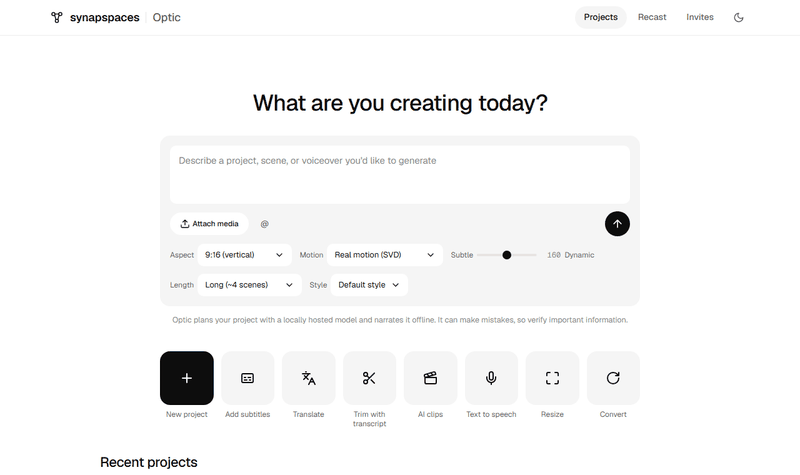

# Synaps Optic Frontend

The HTMX/Jinja2 templates and static assets of the **Synaps Optic** video
editor, packaged as an installable Python distribution (`synaps-optic-frontend`,
import name `optic_frontend`). It contains no application code: only the
template tree, `htmx.min.js`, the Synapspaces design-system stylesheet and fonts
(`static/ds/`), a dark mode built on the same tokens, and the bundled music library.



**To run it**, see [docs/RUNNING.md](docs/RUNNING.md): a one-minute preview of every page with sample
data (`python tools/preview.py --serve`), or the full editor with the backend and a local database.

## How the backend consumes it

`synaps-optic-backend` depends on this package and reads three paths from it:

```python
from optic_frontend import TEMPLATES_DIR, STATIC_DIR, MUSIC_DIR

templates = Jinja2Templates(directory=TEMPLATES_DIR)
templates.env.filters["fromjson"] = json.loads   # templates rely on this filter
app.mount("/static", StaticFiles(directory=STATIC_DIR), name="static")
# MUSIC_DIR == STATIC_DIR / "music": the bundled tracks, served under /static/music
```

### Route contract

The templates hard-code the URL paths they talk to. The backend must serve:

- `/api/...` — JSON and HTMX form endpoints
- `/partials/...` — HTMX partial renders (polling, swaps)
- `/recast/...`, `/projects/...`, `/admin/...`, `/auth/...` — full pages
- `/static/htmx.min.js` — the only static reference in `base.html`

Rendering a page passes `request` (the templates read `request.url.path` and
`request.headers`) plus the per-page context the backend supplies. Changing a
path in a template is a contract change for the backend and needs a version bump.

## Bundled music library

`optic_frontend/static/music/` holds the background-music beds the editor's music picker lists and
the renderer ducks under the voiceover. They are **generated, not downloaded**: `tools/make_music.py`
synthesizes every sample from seeded oscillators and noise (no recordings, samples or models), and
writes a `<slug>.LICENSE.txt` provenance record next to each track.

```bash
pip install -e .[music]                     # numpy; ffmpeg must be on PATH for mp3 output
python tools/make_music.py                  # 4 tracks x 90 s (ambient, cinematic, lofi, uplift)
python tools/make_music.py --check          # 3-5 tracks, LICENSE pair per track, ffprobe-valid
```

The `License:` line of each provenance file starts as `PENDING OWNER REVIEW`; the owner decides the
terms the tracks ship under and stamps them (`--license "CC0 1.0 Universal"` or edit the files).
`--check` fails until that is done. Regenerating with the same `--seed` reproduces the same audio.
The shipped tracks are stamped **CC0 1.0 Universal** (owner decision, 2026-10-13).

## Tests

```sh
python -m venv .venv
.venv/Scripts/python -m pip install -e .[test]      # or .venv/bin/python on POSIX
.venv/Scripts/python -m pytest
```

The tests render the templates through the same Jinja2 setup the backend uses
(see `tests/conftest.py`) and check that the packaged data is complete.

Browser tests (Playwright, `tests/e2e/`) open the pages in Chromium: `pip install -e .[e2e]`,
`python -m playwright install chromium`, then `pytest -m e2e`. See [docs/RUNNING.md](docs/RUNNING.md).

## Releasing

The backend pins this package by git tag (currently `v0.3.9`).

1. Bump `version` in `pyproject.toml` and `__version__` in `optic_frontend/__init__.py`.
2. Commit, then tag: `git tag v0.1.1 && git push --tags`.
3. Update the pin in `synaps-optic-backend`.
